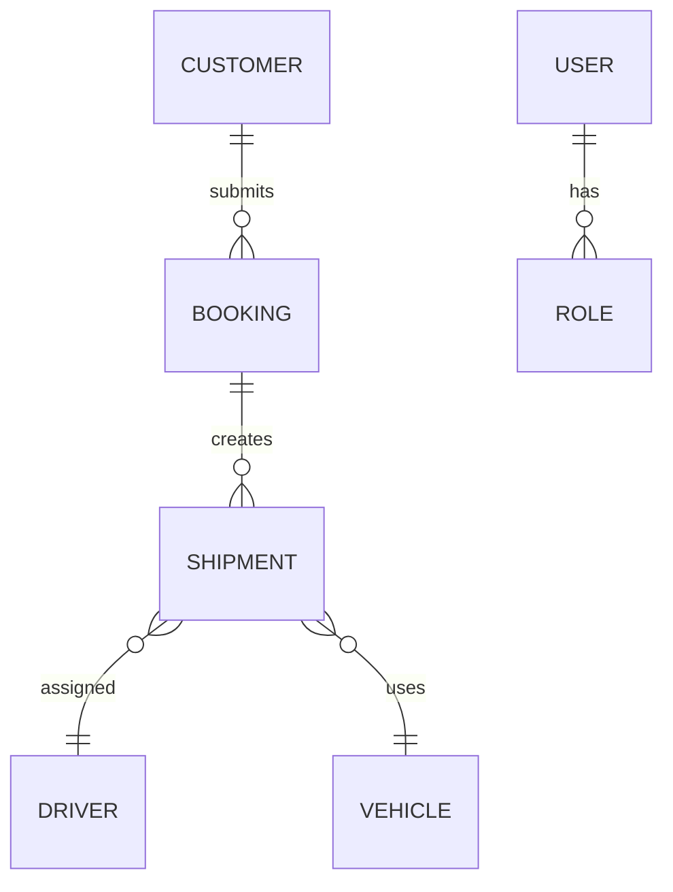

# Database and API Documentation

## Executive summary
This repository does not include a working database or any application backend. There are no data models, schema definitions, migration files, DAO modules, or API routes. The project is a UI-only static website.

## Database architecture
### Current status
- Database system: none
- ORM: none
- Connection config: none
- Migrations: none
- Data model layer: none

### Evidence
- No database driver dependencies in `package.json`
- No `server` or backend directory
- No `.sql` files or migration folders
- No Prisma, Sequelize, Mongoose, or similar schemas

### Database relationship diagram
Because no database implementation exists, the diagram below is conceptual only and does not reflect actual repository code.

## Models and tables
Not implemented in the repository.

Expected domain entities for a real logistics application would include:
- users
- roles
- customers
- bookings
- quotes
- shipments
- routes
- vehicles
- drivers
- payments
- tracking events
- notifications

None of these appear as actual code artifacts.

## Database configuration assessment
No database config file or environment variable references were found. There is no functional database connection string, host, port, username, or schema definition in this repository.

## Migration status
No migration system is present.

This means:
- There is no schema history
- There are no incremental DB changes
- There is no database integrity validation
- There is no test migration baseline

## Integrity and quality findings
- No actual integrity rules exist because no database exists.
- No primary or foreign key constraints exist in code.
- No transactional logic exists.
- No data validation pipeline exists.

## API documentation
### API status
No backend API exists in the current repository.

### Endpoints discovered
None.

### Route patterns that are expected but absent
The following would normally be used by a real transport/logistics system but are currently absent:
- `/api/quotes`
- `/api/bookings`
- `/api/customers`
- `/api/shipments/:id`
- `/api/tracking/:reference`
- `/api/auth/login`
- `/api/auth/logout`
- `/api/admin/dashboard`
- `/api/payments/verify`

### Request flow in the current app
The UI submits no HTTP request. It only updates local state and displays text.

## Frontend to backend boundary
There is currently no boundary.

The current code path is:
- User interaction in the browser
- React state update in `src/App.jsx`
- Local message rendering
- No API call
- No persistence

## Arguably relevant notes from the README
The README makes it clear that the project is a frontend starter and explicitly warns that the following are still missing:
- backend API
- DB for bookings, trips, shipments, drivers
- secure authentication and role permissions
- M-PESA integration
- live shipment tracking integration

This aligns with the codebase findings and confirms the project is not yet connected to real system data.

## Final assessment
The database and API layers are not implemented. The project should be treated as a static brochure and enquiry mockup until a full backend and persistent storage layer are created.
