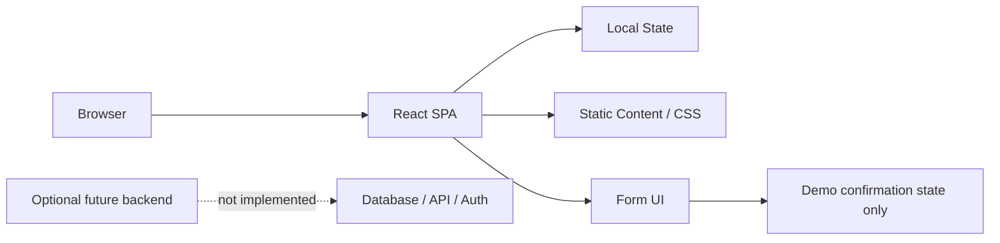
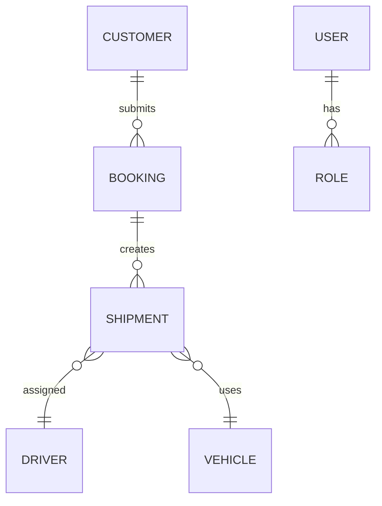

# Dextere Haulers Limited Project Master Report

## Document purpose
This report documents the actual state of the repository as it exists on disk. It is based on direct inspection of the project files and verified build output, not on assumptions from the README alone. The project is a frontend-only marketing and enquiry website for a transport and logistics business, not a full operational logistics management system.

## Verification summary
- Build status: verified successful with `npm run build`.
- Result: Vite production build completed successfully.
- Project type: static React + Vite frontend.
- Backend: not present.
- Database: not present.
- Authentication: not implemented.
- API layer: not implemented.

---

## 1. Project Overview

### What the project is about
This repository contains a single-page website for Dextere Haulers Limited, a transport and logistics company operating in Kenya and East Africa. The site presents the company as a provider of passenger transport, cargo and haulage services, and cross-border logistics.

### What problem it aims to solve
The site is intended to establish a digital presence for the business and support lead generation. It presents services, route coverage, shipment enquiries, and a quote request flow for prospective customers. The project currently serves as a marketing and enquiry landing page rather than a live operations platform.

### Primary purpose
The primary purpose is branding and lead capture for a transport company. It is designed to help users understand the company’s service offerings and submit an enquiry without needing a full operational backend.

### Target users
- Prospective passengers needing transport information.
- Businesses needing cargo and haulage services.
- Regional shippers interested in cross-border freight movement.
- Company administrators who may eventually manage enquiries/booking records.

### Real-world use cases
- A customer wants to ask about moving goods from one town to another.
- A passenger wants to enquire about travel availability.
- A person searches for a logistics company serving Kenya and East Africa.
- A website visitor requests a quote or seeks operational contact details.

### Main objectives
- Present the company and services professionally.
- Offer a clear call-to-action for booking or quote requests.
- Provide a route and service overview.
- Provide a tracking placeholder for future shipment management.

### Project classification
This is best classified as a personal/business marketing website and lead-generation frontend starter, not a SaaS application or the full logistics platform the README warns is still missing.

---

## 2. Technology Stack

### Frontend
- React 18.3.1 — used for rendering the user interface in the single-page app.
- Vite 6.0.5 — used for local development and production builds.
- Lucide React — used for icons in the interface.
- CSS custom styling — the project uses plain CSS in `src/styles.css` rather than a CSS framework.

### Backend
- No backend framework discovered (`express`, `django`, `flask`, `spring`, `next`, etc. were not present).
- No server or application runtime for API handling.

### Database
- No database system found in the repository.
- No ORM, schema files, migrations, or `.sql` files were identified.

### Authentication and authorization
- No authentication library or user management system.
- No JWT, session layer, role-based access control, or protected API routes.

### APIs and third-party integrations
- Google Fonts via CSS `@import` for typography.
- Unsplash background image URL for the hero section.
- No backend-integrated API calls or real data retrieval.

### Payment integrations
- No Stripe, PayPal, M-PESA, Paystack, or other payment provider integration was found.

### UI framework/style system
- Custom CSS design system with color variables and responsive media queries.
- Brand identity: green, orange, white.

### Development tools
- Node.js + npm — standard tooling for Vite React app.
- Vite dev/build tooling for local preview and production bundling.

### Deployment platforms
- README suggests static host deployment such as Netlify or Vercel.
- No production deployment configuration or CI/CD pipeline files were found.

### Background workers / task queues
- None.

### Infrastructure and hosting
- No cloud infrastructure code, Docker, serverless config, or platform specification was found.

---

## 3. Project Architecture

### High-level architecture
The project is a single-page frontend application with local UI state only. It has no backend service, database, or API. The architecture is effectively:

### Frontend structure
- `src/App.jsx` contains the full page layout and sections.
- `src/styles.css` contains the design system and responsive styling.
- `src/main.jsx` mounts the React app into `index.html`.

### Backend structure
- No backend app or service layer exists.
- There is no Express/Nest/Next API backend, no database server, and no server-side logic.

### Database architecture
- There is no persistent database layer or data model.
- No migrations or schema definitions are present.

### Application modules
The application is effectively one monolithic component with sections:
- Header/navigation
- Hero banner
- Services section
- Coverage section
- Tracking form
- Booking form
- Footer

### API communication
- There is no API layer.
- The tracking and booking actions do not make HTTP requests.

### Authentication flow
- None. No login, registration, or authorization system exists.

### Data flow
User interaction in the browser updates React state, then the UI changes message text or set `sent` to `true`. There is no persistence or outbound request.

### External services
Only static third-party external assets are used:
- Google Fonts
- Unsplash hero image

### Relationships between modules
The relationship is trivial: HTML shell → React root → single App component → CSS styling. No separated modules or bounded contexts exist.

---

## 4. Features and Functionality

### 1. Landing page and branded marketing site
- Purpose: present the company and its offerings.
- Implementation: `src/App.jsx` hero section, navigation, service cards, coverage section, footer.
- Data source: embedded static arrays and JSX markup.
- Status: functionally present and operational as a static page.

### 2. Service information display
- Purpose: explain core offerings.
- Implementation: `services` array and mapping in `App.jsx`.
- Status: present and visually complete.

### 3. Route and coverage section
- Purpose: communicate geographic operations.
- Implementation: country tags and route visuals in `App.jsx` and `styles.css`.
- Status: decorative and informational only; no real route data or map integration.

### 4. Shipment tracking enquiry form
- Purpose: allow a user to submit a reference number for tracking.
- Implementation: `handleTrack` in `App.jsx`.
- Behavior: if a tracking value is entered, it displays a placeholder message; if empty, it asks for a tracking reference.
- Status: placeholder only; no lookup, no API, no backend.

### 5. Booking request / quotation form
- Purpose: collect customer transport enquiry details.
- Implementation: booking form in `App.jsx` and `handleBooking`.
- Behavior: sets local state `sent=true` and shows a success note.
- Status: demo-only; does not send or save data.

### 6. Contact details display
- Purpose: give a likely contact path to the company.
- Implementation: telephone and email lines in booking section.
- Status: present as static text and flagged in README as needing verification before live use.

### 7. Responsive mobile menu
- Purpose: compact navigation on smaller screens.
- Implementation: `menuOpen` state, CSS media queries.
- Status: works as a UI interaction; not connected to any backend.

### 8. Brand asset usage
- Purpose: show company logo and identity.
- Implementation: `public/dextere-logo.jpg` and CSS theme.
- Status: present and functional.

### 9. Static legal/corporate presentation
- Purpose: provide a professional tone and public-facing company branding.
- Implementation: static text and sections.
- Status: present, but not a legal compliance layer.

### Feature status summary
- Fully functional: static marketing rendering, form UI presentation, responsive layout, mobile menu.
- Partially implemented: tracking and booking interactions are UI-only placeholders.
- Not functional: any real submission, tracking, persistence, payment, or operational workflow.

---

## 5. Database Analysis

### Database status
No database is configured in this project. There are no ORM models, migration files, or database configuration files. This is a frontend-only repository.

### What was inspected
- `package.json` dependencies show no database drivers.
- `src` folder contains no data model files.
- No `.env` or environment configuration file was found for database credentials.
- No `.sql`, Prisma schemas, Sequelize models, Mongoose models, or similar files were discovered.

### Database architecture assessment
The repository has no database architecture, no connections, and no migrations. This project is not an application with persistent business data yet.

### Data model status
No data model exists for:
- Customers
- Trips
- Shipments
- Bookings
- Drivers
- Fleet
- Cargo records
- Users and roles

### Risks
- There is no transactional history for bookings or shipments.
- There is no data integrity enforcement.
- There is no storage for enquiries or records.
- There is no basis for auditing or operational tracking.

### Relationship diagram (conceptual)

This is conceptual only; no actual implementation exists in the repository.

---

## 6. API Documentation

### API status
No backend or HTTP API exists in the project. There are no Express routes, FastAPI endpoints, GraphQL resolvers, Firebase functions, Laravel routes, or backend controllers.

### Discovered client actions
The UI handlers in `App.jsx` are not HTTP calls. They are local event handlers that update React state.

| Feature | Method | URL | Purpose | Auth needed | Status |
|---|---|---|---|---|---|
| Shipment tracking | Client-side state update | None | Validate input and return placeholder message | None | Placeholder |
| Booking enquiry | Client-side state update | None | Trigger local success state | None | Placeholder |

### Actual endpoints summary
None found.

### Missing endpoints
The following would normally be expected in a real logistics application, but are absent:
- `/api/bookings`
- `/api/shipments/:id`
- `/api/tracking/:reference`
- `/api/auth/login`
- `/api/users`
- `/api/admin/quotes`
- `/api/payments/verify`

### Duplicated or non-connected endpoints
None found, because there is no API layer.

### Frontend-backend connectivity status
No frontend-to-backend integration exists. The booking and tracking forms are disconnected from any backend or service layer.

---

## 7. Frontend Analysis

### Main pages/sections
The app is a single-page landing page with sections defined in `App.jsx`:

1. Header / navigation
2. Hero section
3. Quick stats strip
4. Service overview
5. Coverage / network section
6. Tracking panel
7. Booking / enquiry form
8. Footer

### Navigation behavior
Navigation links scroll to in-page anchors (`#home`, `#services`, `#coverage`, `#tracking`, `#booking`). The menu toggles mobile state with `menuOpen` and uses `aria-label` for accessibility.

### Forms and validation
- Tracking form: uses `required` conditional at the UI handler level; no actual backend validation.
- Booking form: uses HTML `required` attributes on several fields.
- No complex client-side validation library or schema validation exists.

### Loading and error handling
- No asynchronous requests are made.
- No loading spinners or network error states exist.
- Tracking and booking actions show static text based on local state only.

### UI data source
Everything is static, embedded in JSX and arrays. There is no API-driven data model or CMS connection.

### Responsive design
The project includes CSS media queries for tablet/mobile breakpoints. Layout adapts to smaller screens using two-column and one-column transforms.

### Unimplemented UI actions
- `Track Shipment` is a placeholder.
- `Send enquiry` is a self-contained demo state only.
- No admin dashboard or account portal exists.
- No route search, trip booking flow, or live tracking panel exists.

### Verified frontend behavior
The app renders correctly and the production build succeeds. However, it is a front-end mockup rather than a complete operational product.

---

## 8. Authentication and Security

### Authentication state
No authentication system exists. There are no user accounts, login pages, sessions, or role models.

### Authorization state
No role-based permissions, access control, or protected routes exist.

### Security controls present
- Basic HTML form validation for some fields.
- Strong static assets and no obvious secret exposure in source code.
- No environment variables with API keys or credentials were identified.

### Security concerns and gaps
- There is no server-side validation, because there is no server.
- There is no backend protection against spam submissions.
- The booking form is not connected to an email or database backend, so there is no secure submission pipeline.
- The website advertises a business identity and contact info in public source code, which is expected for a public site but should be reviewed for accuracy before deployment.
- No HTTPS enforcement is configured because this is static frontend code; production hosting must enforce HTTPS at the platform level.

### Security posture summary
The repository itself does not expose credentials because there is no backend or environment file with secrets. However, the project does not implement any meaningful application security beyond front-end presentation. This should be considered a placeholder security posture, not a production-ready secure system.

---

## 9. Third-Party Integrations

### Google Fonts
- Purpose: typography.
- Status: connected via CSS import.
- Verified: yes.

### Unsplash,
- Purpose: large background image in hero section.
- Status: connected via CDN URL.
- Verified: yes.

### Planned or missing integrations
The README explicitly lists the following as necessary but not implemented:
- M-PESA Daraja integration
- Real route/timetable/fare data
- Shipment database and API
- Driver, vehicle, fleet management
- GPS/tracking hardware or mobile integration
- Email / CRM / ticketing backend
- Customer booking, quotation and payment workflows

### Integration assessment
There are no real functional third-party integrations. The project currently depends only on static assets and the browser environment.

---

## 10. Deployment and Environment

### Local run instructions
The README specifies:
1. Install Node.js LTS
2. Run `npm install`
3. Run `npm run dev`
4. Open the Vite URL

### Build instructions
- `npm run build` — verified build passes.
- Output is generated in the `dist` folder.

### Hosting and deployment model
The README states the built `dist` folder can be uploaded to static hosts like Netlify or Vercel.

### Environment variables
No `.env` files or environment variable configuration were discovered. No variable names are defined in code.

### Database setup
None. No database service or migration step is required in the current repository.

### Production vs development configuration
- Development: `npm run dev` with Vite.
- Production: `npm run build` generating static assets.
- No `docker-compose`, `nginx`, or server config files were found.

### Deployment status
The codebase is deployable as a static frontend site, but it is not production-ready for operational or real booking use because no backend, database, or secure workflow exists.

---

## 11. Current Development Status

### Completed
- The company branding and marketing site is complete enough to present the business.
- Responsive layout is implemented.
- Production build passes.
- Contact and service content is in place.

### Currently being developed or incomplete
The README states many missing and required systems, including:
- Booking backend and submission handling
- Shipment tracking backend
- Static company data verification
- Payment integration
- Real freight and passenger operations data
- Authentication and admin access

### Partially implemented
- Tracking input field and message handling are implemented but do nothing meaningful.
- Booking enquiry form is implemented but does not submit or persist data.
- Navigation and UI states work locally, but no actual business flow is connected.

### Missing
- Database and persistent data store
- Server-side API
- User management and authorization
- Actual operational data for routes, vehicles, routes, and tracking
- Payment and reconciliation systems
- Contact form processing

### Verified problems
- No backend exists.
- No database exists.
- No authentication exists.
- Tracking and booking are demo-only.
- The project is a frontend starter, not a complete logistics platform.

### Suspected or likely issues
- The public marketing claims may be too broad for production until verified by business data.
- The website has not been tested against real commercial operations or regulatory requirements.

---

## 12. Code Quality and Technical Risks

### Code organization
The code is simple and easy to follow, but it is tightly concentrated in a single React component. This is acceptable for a small marketing site, but it becomes a maintenance risk as the project grows.

### Reusability
Low reuse at this stage. The page content and styling are embedded directly in the app with no component library or modular architecture.

### Naming conventions
- Component and state names are clear and readable.
- `handleTrack`, `handleBooking`, and `bookingType` follow reasonable naming patterns.

### Error handling
Very limited. In a real application, there would need to be API error states, validation errors, and graceful fallback handling.

### Performance
Static frontend performance is good. The bundle is lightweight. There are no obvious CPU-heavy operations or expensive repeated render patterns.

### Scalability
Low to moderate. The current architecture works for a small static brand site but does not scale to a real logistics operations platform without major backend and data-layer additions.

### Maintainability
Moderate for a starter site. It can be maintained easily, but the project is not yet organized around domain modules or business workflows.

### Duplicate code or dead code
There is no obvious duplicate code, though the app contains a lot of inline static content in a single file.

### Unused files and dependencies
- `public/dextere-logo.jpg` is used.
- `lucide-react` is used for icons.
- There are no obvious unused source files.
- The repository is small and mostly focused on a single front-end experience.

### Architectural weaknesses
- Single-component app structure
- No backend separation
- No persistent data layer
- No security model
- No tests
- No real operational workflows

This is not a major rewrite issue; it is simply a prototype/marketing site that has not yet reached the stage of a business application.

---

## 13. Project Roadmap

### 1. Critical fixes
1. Replace demo booking and tracking logic with real backend-driven workflows.
2. Add a real database and data model for enquiries, bookings, shipments, and customers.
3. Verify all business contact details, route claims, and service coverage before publishing.
4. Decide whether the site is a marketing landing page only or a real operations platform.

### 2. Incomplete existing functionality
1. Staff or admin side for enquiries and tracking status.
2. Real quote request and enquiry storage.
3. A proper tracking lookup and status update process.

### 3. Essential features
1. User management and authentication for staff/admin access.
2. Booking pipeline with status updates.
3. Shipment lifecycle tracking.
4. Route and pricing management.
5. Search and filtering for passenger and cargo offerings.

### 4. Integrations
1. Email and CRM system for enquiry submissions.
2. M-PESA/Daraja for payments where applicable.
3. Map and route integration.
4. SMS or WhatsApp notifications.
5. Fleet and driver management APIs.

### 5. Performance and security improvements
1. Add a real backend with validation and rate limiting.
2. Secure API endpoints and environment-based configuration.
3. Define access rules and role-based permissions.
4. Add automated tests and end-to-end checks.

### 6. Future enhancements
1. Real-time shipment tracking.
2. Driver and vehicle dashboards.
3. Revenue and operational analytics.
4. Customer portal.
5. Route scheduling, compliance, and maintenance workflows.

---

## 14. Important Files and Directories

### Root files
- `README.md` — project overview and deployment guidance for the frontend starter.
- `package.json` — React/Vite project metadata and scripts.
- `index.html` — base HTML shell for the app.
- `public/dextere-logo.jpg` — company brand image.

### Source directory
- `src/main.jsx` — bootstraps the React app into the DOM.
- `src/App.jsx` — main application component containing page structure and form logic.
- `src/styles.css` — the complete styling and responsive design of the site.

### Notable observations
- There is no `server`, `api`, `db`, `models`, `controllers`, `middleware`, or `config` directory.
- There is no `auth`, `payments`, or `services` backend layer.
- The codebase is intentionally small and centered around the landing page experience.

---

## Final assessment
This repository is not yet a full logistics system. It is a static front-end starter designed to market a transport business and collect website enquiries in a demo or placeholder form. The code is clean and buildable, but it is not operationally complete. The strongest recommendation is to decide early whether this project should remain a marketing site or evolve into a real logistics platform, because the current code and structure are only suitable for the former stage.
