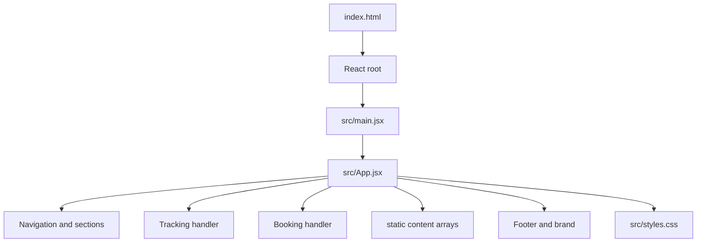

# Project Structure and File Responsibilities

## Repository overview
This repository is a small frontend-only React application for a transport and logistics company. It contains a static landing page and placeholder enquiry/tracking flows. It does not include a backend, database, or operational service layer.

## Root-level files

### README.md
Purpose:
- Describes the project as a frontend starter.
- Explains how to run the app locally.
- Warns that booking and tracking functionality are placeholders and require a real backend, database, and payment/integration work.

Importance:
- This is the most important high-level source of truth for the current project maturity.

### package.json
Purpose:
- Declares the project name, scripts, and dependency list.
- Scripts:
  - `npm run dev` for local development
  - `npm run build` for production bundle creation
  - `npm run preview` for local preview

Importance:
- Confirms the project is a React + Vite app with a small dependency set.

### index.html
Purpose:
- Defines the browser entry point and mount location (`#root`).
- Loads the main React app script.

Importance:
- Very minimal; no custom hydration logic or server-side rendering.

### public/dextere-logo.jpg
Purpose:
- Stores the company logo used in the header and footer.

Importance:
- Brand asset only; no application logic attached.

---

## Source directory

### src/main.jsx
Purpose:
- Creates the root application container.
- Imports the main `App` component.
- Renders the app into the DOM with React StrictMode.

Functionality:
- Connects the React app to the browser.
- Loads global stylesheet via `./styles.css`.

### src/App.jsx
Purpose:
- This is the main application file.
- Contains the full marketing page structure, service content, tracking form, booking form, and footer.

Responsibilities:
- Navigation and mobile menu state
- Service content listing
- Coverage/coverage map styling section
- Tracking form logic (`handleTrack`)
- Quote/request form logic (`handleBooking`)
- Contact details section
- Footer branding text

Important detail:
- The logic is all local UI state. No API request or database interaction occurs.

### src/styles.css
Purpose:
- Contains the complete design system, layout, colors, responsive breakpoints, and component styling.

Responsibilities:
- Brand colors and typography
- Header and hero design
- Service cards and coverage visuals
- Tracking and booking form styling
- Responsive behavior for mobile/tablet screens

Importance:
- This file effectively defines the visual identity of the frontend.

---

## What is not present
The project does not contain the following directories or structures that would be expected in a real application:

- `src/api/`
- `src/components/`
- `src/pages/`
- `src/hooks/`
- `src/services/`
- `src/store/`
- `server/`
- `backend/`
- `models/`
- `migrations/`
- `config/`
- `auth/`
- `database/`

This is an important architectural fact: the repository is intentionally minimal and frontend-only.

---

## High-level module map

## Maintainer guidance
If another developer takes over this project, the most important files to understand are:
1. `README.md` — project maturity and current warnings
2. `src/App.jsx` — the single main component containing the real user experience
3. `src/styles.css` — the design and responsive rules
4. `package.json` — runtime and build commands

No other domain modules exist at present, so there is no deeper codebase architecture to review yet.
